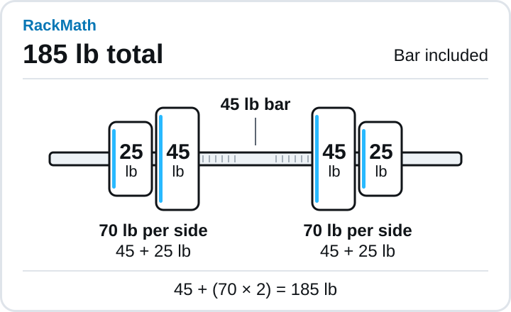
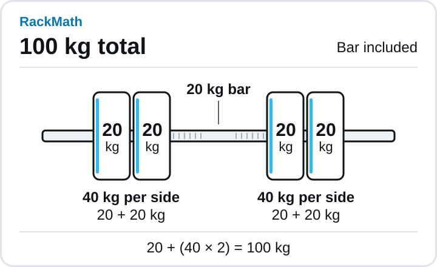

# How to Calculate Plates on a Barbell

*Updated November 18, 2026. Visual examples and a printable reference chart included.*

To calculate plates on a barbell, subtract the empty bar weight from your target weight, divide the remainder by two, and build that amount on each side with the plates available at your gym.

> **Plates per side = (target weight − bar weight) ÷ 2**

The examples below exclude collars. If your target includes weighted collars, subtract their combined weight along with the bar weight before dividing by two.

For example, a 225 lb target with a 45 lb bar leaves 180 lb for plates. Divide by two and you need 90 lb per side: two 45 lb plates on each sleeve.

If you want the answer without doing the arithmetic, use the [free Barbell Calculator](/tools/barbell-calculator). You can choose pounds or kilograms, change the bar, select the plate sizes you have, and see the matching load.

[Download the printable barbell plate chart (PDF, 1 page)](/assets/guides/barbell-plate-reference.pdf). Keep the pound and kilogram tables together on your phone or print them for your gym. No signup needed.

## The three numbers you need

Before calculating anything, identify:

1. **Your target total.** This is the full weight you intend to lift, including the bar.
2. **The empty bar weight.** A full-size bar may be 45 lb or 20 kg, but bars vary.
3. **The plate sizes available.** The mathematical answer only works if your gym has plates that can build it.

Do not automatically assume every bar weighs 45 lb. Women's Olympic bars, technique bars, trap bars, safety squat bars, and Smith machines can be different. Use the label, ask the gym, or review [how to identify what a barbell weighs](/blog/what-does-the-bar-weigh) before loading.

## Calculate the load step by step

### Step 1: Subtract the bar

Suppose the target is 185 lb and the bar weighs 45 lb:

> 185 − 45 = 140 lb of plates in total

This is the combined plate weight for both sleeves.

### Step 2: Divide by two

The two sides must match:

> 140 ÷ 2 = 70 lb per side

### Step 3: Build the per-side amount

One way to build 70 lb is:

- 45 lb
- 25 lb
- **70 lb per side**

Repeat that same stack on the other sleeve. The finished bar is:

> 45 lb bar + 70 lb left + 70 lb right = 185 lb

**Read every stack in this guide as plates for one side.** A stack of 45 + 25 means one of each plate on the left and one of each on the right: four plates altogether.

## Pound plate chart: a 45 lb bar

The total includes the bar. Plate stacks run from the largest plate to the smallest. These are example combinations; other combinations can give the same total.

| Total weight (lb) | Plate weight per side (lb) | Plates on each side (lb) |
| --- | --- | --- |
| 45 | 0 | None |
| 65 | 10 | 10 |
| 95 | 25 | 25 |
| 115 | 35 | 35 |
| 135 | 45 | 45 |
| 155 | 55 | 45 + 10 |
| 185 | 70 | 45 + 25 |
| 205 | 80 | 45 + 35 |
| 225 | 90 | 45 + 45 |
| 275 | 115 | 45 + 45 + 25 |
| 315 | 135 | 45 + 45 + 45 |
| 405 | 180 | 45 + 45 + 45 + 45 |

### What does "two plates" mean?

When someone describes 225 lb as "two plates," they usually mean two 45 lb plates **on each side** of a 45 lb bar. That is four plates altogether:

> 45 + (2 × 45) + (2 × 45) = 225 lb

Always confirm the plate and bar weights. "Two plates" with 20 kg plates on a 20 kg bar is 100 kg, so the phrase alone does not specify the total weight.

For another total or a different bar, use the [barbell calculator](/tools/barbell-calculator). See [common barbell weights](/tools/common-barbell-weights) for more loading examples.

## Kilogram plate chart: a 20 kg bar

Use kilogram plates with this table. A 20 kg bar is about 44.1 lb, so it is not exactly the same as a 45 lb bar. Each table uses its own stated bar weight.

| Total weight (kg) | Plate weight per side (kg) | Plates on each side (kg) |
| --- | --- | --- |
| 20 | 0 | None |
| 30 | 5 | 5 |
| 40 | 10 | 10 |
| 50 | 15 | 15 |
| 60 | 20 | 20 |
| 80 | 30 | 20 + 10 |
| 100 | 40 | 20 + 20 |
| 120 | 50 | 20 + 20 + 10 |
| 140 | 60 | 20 + 20 + 20 |
| 160 | 70 | 20 + 20 + 20 + 10 |
| 180 | 80 | 20 + 20 + 20 + 20 |
| 200 | 90 | 20 + 20 + 20 + 20 + 10 |

### Visual example: 100 kg

Subtract the 20 kg bar from 100 kg to leave 80 kg of plates. Divide by two: 40 kg per side. Two 20 kg plates on each sleeve make the required load.

**Table assumptions:** collars are not included, both sides match, and you have enough of each listed plate. Read the labels on your equipment; these tables do not account for manufacturing tolerances.

If your program and gym use different systems, the [lb and kg plate converter](/tools/lb-kg-plate-converter) will convert the target before you choose a practical plate setup.

## Using a different bar or a limited plate set

The formula stays the same when the bar changes. For **60 kg on a 15 kg bar**:

> (60 − 15) ÷ 2 = 22.5 kg per side

One 20 kg plate plus one 2.5 kg plate on each side makes 60 kg in total. A 15 kg bar loaded like the 60 kg row in the 20 kg-bar table would total only 55 kg.

You also need enough physical plates. The 225 lb example requires **four 45 lb plates**, not two. If your gym has just one pair, another available combination must provide the same 90 lb per side. For example, 45 + 25 + 10 + 10 works if you have enough of all three sizes.

The free RackMath calculator lets you choose plate sizes but assumes each selected size is available as needed. Check that you have enough physical plates of every size shown.

## What if the exact weight is not loadable?

Correct arithmetic does not guarantee that your available plates can make the target.

Consider a 223 lb target, a 45 lb bar, and common plates down to 2.5 lb:

1. 223 − 45 = 178 lb of plates total.
2. 178 ÷ 2 = 89 lb per side.
3. A gym whose smallest plate is 2.5 lb changes the total in 5 lb increments, so 89 lb per side cannot be built exactly.

In that situation, choose a nearby load that your equipment can make rather than loading the two sides differently. RackMath loads the selected plate sizes from largest to smallest; if that stack leaves a remainder, it reports the lower weight built by that calculation.

With some plate selections, another combination can reach the target even when the calculator's first combination cannot. Check the plate sizes and the arithmetic before deciding a total is impossible.

With this example, **220 lb** is loadable: a 45 lb bar plus 45 + 25 + 10 + 5 + 2.5 on each side. Enter 220 in the calculator to display that stack, and check the actual total before logging the lift.

Fractional plates can create smaller jumps. Collars can also add weight, but their weight varies and the free web calculator has no collar-weight input. Verify unfamiliar bars or collars before treating the result as exact.

## Common plate-math mistakes

### Forgetting that the bar counts

Two 45 lb plates do not make a 90 lb lift when they are on a 45 lb bar. The total is 135 lb.

### Dividing the target instead of the plate remainder

For 95 lb, do not divide 95 by two. Subtract the 45 lb bar first, then divide the remaining 50 lb.

### Counting only one side

If one sleeve has a 25 and a 10, that is 35 lb on one side—not 35 lb in total. The matching sleeve adds another 35 lb.

### Assuming every bar is identical

Switching from a 35 lb bar to a 45 lb bar changes the total by 10 lb even when the plate stack stays the same.

### Making the totals equal with different stacks

It may be mathematically possible to create the same weight with different plate combinations, but mirroring the stacks makes the setup easier to verify. Put the same plates in the same order on both sleeves.

## A quick loading check

Before the set:

1. Confirm the target and bar weight.
2. Check that both sides have the same plates in the same order.
3. Push the plates fully onto the sleeves.
4. Use collars when appropriate for the lift and your gym's rules.
5. Step back and compare both sides once more.

For the physical process of adding, alternating, securing, and removing plates, use the [beginner's guide to loading a barbell](/blog/the-beginners-guide-to-loading-a-barbell).

## Save the chart or calculate your next load

The formula is useful because it lets you verify any result:

> **Target − bar, divided by two, equals plates per side.**

When you want the visual answer, open the [RackMath Barbell Calculator](/tools/barbell-calculator), enter your target, and match the plate stack it shows on both sides. From there, you can continue the same weight in the RackMath app if you want to track the lift.

[Save or print the one-page lb/kg chart](/assets/guides/barbell-plate-reference.pdf) for a quick reference. Coaches and gym owners are welcome to share the unmodified chart with RackMath attribution. Link to this guide so readers can find the calculator and any future updates.
